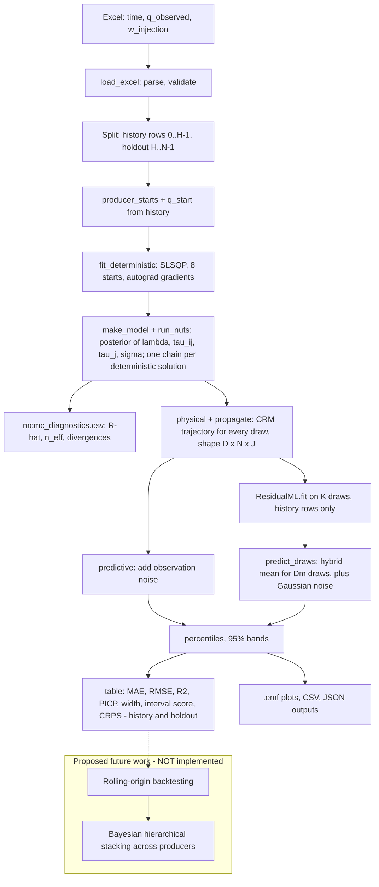

# Methodology: Bayesian CRM with Machine-Learning Residual Correction (`crm-ml-beta.py`)

**Basis of this document.** Static reading of `crm-ml-beta.py` only. Nothing was executed. The workbook, `metrics(2).csv`, posterior/diagnostic outputs, the CRM source article (Ogali and Orodu 2025, as cited in the code comments), the Yao et al. (2022) PDF and any README were **not available in this session**, so no numerical results are reported or implied. `crm_ml_bayes_uq.md` (referred to in the code's docstring) was also unavailable. Literature was *not* browsed (to save resources); references in Section 17 are from the author's knowledge and **must be checked against the publishers' pages before submission**. Where the code and its comments disagree, the executable behaviour is documented and the discrepancy flagged (collected in Section 15).

**Notation.** $N$ rows in total; $H$ history rows (indices $0,\dots,H-1$); $F=N-H$ holdout rows (default $F=12$); $I$ injectors, $J$ producers; $t_n$ time of row $n$, $\Delta t_n=t_n-t_{n-1}$; $y_{nj}$ observed rate of producer $j$; $w_i(t_n)$ injection rate of injector $i$; $s_j$ start row of producer $j$; $\hat q_{nj}(\theta)$ CRM rate; $\theta=(\tau_j,\lambda_{ij},\tau_{ij})$.

---

## 1. Research Objective and Methodological Overview

The task is to forecast producer rates and quantify forecast uncertainty. Three layers are implemented:

1. **CRM** (capacitance–resistance model): a physics-based, injection-driven rate model (Yousef et al. 2006; Sayarpour et al. 2009).
2. **Bayesian UQ**: a NUTS posterior over $\theta$ and a noise scale $\sigma_j$ (Hoffman and Gelman 2014). Every posterior draw is run through the CRM, giving a distribution of trajectories.
3. **ML residual corrector**: a per-producer regressor trained on CRM residuals from a subset of posterior draws, applied to every draw (Section 8).

The last $F$ rows are never used for fitting, sampling, training or hyper-parameter choice (code docstring; verified in the data flow below), subject to the inner-validation caveat in Section 8.4.

---

## 2. Data Sources and Data Preparation

**Workbook (`load_excel`).** Sheets are found case-insensitively by alias: time (`time`, `t`), production (`q_observed`, `production`), injection (`w_injection`, `injection`); an optional `distances` sheet. For each sheet (`_numeric_block`): empty rows are dropped; the **first non-empty row is the header** and supplies producer/injector names (so names are aligned to columns by position); the remaining cells are coerced to numbers; any row containing a non-numeric cell becomes NaN and is dropped, which removes a units row such as `[MSTB/day]`. **Confirmed side effect:** a genuinely missing value in a data row also silently drops that row *within that sheet only*; the sheets are length-checked afterwards, so unequal drops raise an error but equal drops in different rows would misalign the series undetected.

**Validation.** Equal lengths; strictly increasing time; non-negative, finite production and injection. Time unit is whatever the workbook uses; it is not declared in code. The default `--tau-min = 1/30.44` and the comments ("1 day = 1/30.44 month") assume a **monthly** axis, whereas plot labels read "Time (day)". The workbook was not available, so the unit could not be confirmed; this is an open inconsistency.

**Distances.** Loaded into `CRMData.distances` but never used by any model or feature.

**Zero production and starts.** `producer_starts` returns the first row with $y>0$ in the **history** for each producer (error if none). Before $s_j$ the CRM output is exactly 0 and the row is excluded from likelihoods; the start row holds the observed rate $y_{s_jj}$ (treated as exact; no initial-state uncertainty). Zeros *after* the start (shut-ins) remain in the data; their treatment depends on the likelihood (Section 5). A producer first producing in the holdout would raise an error.

**Split.** $H=N-F$ (error if $H<10$). History = first $H$ rows; holdout = last $F$ rows. Holdout injection rates enter the forecast as known inputs (an assumption).

---

## 3. Mathematical Foundation of the CRM

The implemented producer-based CRM (comment: "Eq. 1 without BHP term", Ogali and Orodu 2025; equation number and bibliographic details **not verified**) is, for $n>s_j$,

$$
\hat q_{nj}= y_{s_jj}\,e^{-(t_n-t_{s_j})/\tau_j}+\sum_{i=1}^{I}\lambda_{ij}\sum_{m=s_j+1}^{n}\Big[e^{-(t_n-t_m)/\tau_{ij}}-e^{-(t_n-t_{m-1})/\tau_{ij}}\Big]w_i(t_m), \tag{1}
$$

with $\hat q_{s_jj}=y_{s_jj}$ and $\hat q_{nj}=0$ for $n<s_j$. Terms: first = exponential decline of the initial rate with producer time constant $\tau_j$; $\lambda_{ij}\in[0,1]$ connectivity from injector $i$ to producer $j$; $\tau_{ij}$ response time of that pair. The bracket equals $(1-e^{-\Delta t_m/\tau_{ij}})e^{-(t_n-t_m)/\tau_{ij}}$, i.e. exact integration of a piecewise-constant injection over each step, so Eq. (1) is equivalent to the recurrence used in JAX (`crm_jax`):

$$
R_{ij}(n)=e^{-\Delta t_n/\tau_{ij}}R_{ij}(n-1)+\big(1-e^{-\Delta t_n/\tau_{ij}}\big)w_i(t_n),\quad R_{ij}(s_j)=0,\qquad \hat q_{nj}=y_{s_jj}e^{-(t_n-t_{s_j})/\tau_j}+\sum_i\lambda_{ij}R_{ij}(n). \tag{2}
$$

The PyTorch class `CRMForward` evaluates the kernel form (1) with $[J,N,N]$ masks; `crm_jax` evaluates (2) with `lax.scan`. The self-tests (not run here) compare them. **Omitted terms:** the bottom-hole-pressure term of the source article. Consequently pressure-driven rate changes are attributed to the residual (and to the ML corrector, which also lacks pressure inputs). Injector-specific contributions $\lambda_{ij}R_{ij}(n)$ are returned by `CRMForward.contributions` / `crm_contrib_jax` (shape $[N,J,I]$) for ML features.

---

## 4. Deterministic CRM Calibration (`fit_deterministic`)

Purpose: a baseline trajectory and starting values for the sampler. **It is an optimisation, not a posterior.**

- **Parameters** $x=[\log\tau_j\ (J),\ \lambda_{ij}\ (IJ),\ \log\tau_{ij}\ (IJ)]$, estimated simultaneously.
- **Objective** (history only, $N\to H$ here):
$$\mathcal J(\theta)=\frac{1}{HJ}\sum_{j}\sum_{n=s_j+1}^{H-1}\big(y_{nj}-\hat q_{nj}(\theta)\big)^2. \tag{3}$$
Zero (shut-in) rows after the start are ordinary targets.
- **Bounds:** $\log\tau\in[\log\tau_{\min},\log\tau_{\max}]$, $\tau_{\max}=1000\,H$ (default), $\lambda\in[0,1]$.
- **Constraint (injector-wise):** $\sum_{j}\lambda_{ij}\le1$ for every injector $i$ (linear inequality $1-Ax\ge0$).
- **Algorithm:** SLSQP (Kraft 1988; via SciPy, Virtanen et al. 2020), `maxiter=1000`, `ftol=1e-12`, exact gradients by PyTorch autograd.
- **Multi-start (8 by default):** start 0 sets $\tau=10$ (clipped to bounds) and $\lambda=1/J-10^{-5}$; others draw $\log\tau\sim U[\log\max(\tau_{\min},0.1),\log\min(\tau_{\max},10H)]$ and $\lambda_{ij}\sim U(0,0.95/J)$ (so row sums $\le0.95$).
- **Selection:** the lowest finite objective, **regardless of the SLSQP `success` flag**. Per-start `success`, `status`, `message`, `nit`, maximum constraint violation and gap to best are saved (`deterministic_starts.csv`). All solutions, sorted by objective, are kept; chain $c$ of NUTS starts from solution $c \bmod$ (number of solutions).
- The result is pickled under a name built from $H$, starts, iterations, seed and $\tau_{\min}$ — **not the data contents**; a changed workbook with identical settings would reuse a stale fit.

Citation status: least-squares CRM fitting follows the cited CRM literature; the multi-start/SLSQP/autograd choices are engineering decisions.

---

## 5. Bayesian CRM Formulation (`make_model`)

**Latent variables and priors**

| Quantity | Prior as coded | Notes |
|---|---|---|
| $\log\tau_j,\ \log\tau_{ij}$ | `Uniform(lo,hi)` site **plus** `numpyro.factor` of $\mathcal N(\log 10,\ \text{sd}^2)$ log-density | density $\propto \mathcal N(\log\tau;\log10,\text{sd}^2)\,\mathbf 1[\log\tau_{\min}\le\log\tau\le\log\tau_{\max}]$ |
| $\lambda_{ij}$ | independent $\mathrm{Beta}(\alpha,\beta)$, `to_event(2)`; defaults $\alpha=1,\ \beta=J$ | each in $(0,1)$ |
| $\sigma_j$ | $\text{HalfNormal}(c_j)$ | $c_j=$ SD of history rates after start (normal, AR(1)) or $1$ (lognormal): data-dependent scale |
| $\phi_j$ (AR(1) only) | $U(-0.99,0.99)$ | |

*Time-constant prior.* The uniform contributes a constant on its support, so the product is the truncated Normal on $[\log\tau_{\min},\log\tau_{\max}]$ **up to a parameter-independent normalising constant**; the posterior is therefore identical to using a truncated Normal. The Bayesian upper bound is $\tau_{\max}=4.5H$ (passed in `run_pipeline`), **not** the $1000H$ of the deterministic fit; deterministic values above $4.5H$ are clipped by `init_values`. Default prior mean $\tau=10$ time units, SD 2 (log scale).

*Connectivity prior.* Each $\lambda_{ij}$ has its own Beta prior; **nothing ties the coefficients of one injector together**. There is no slack variable and no Dirichlet. The prior therefore does **not** enforce $\sum_j\lambda_{ij}\le1$ (injector-wise mass balance): with $\mathrm{Beta}(1,J)$ the mean of each is $1/(J+1)$, the mean of an injector's sum is $J/(J+1)$, and sums above 1 have non-zero prior and posterior probability. The code reports `max_injector_lambda_sum` and the share of draws with any sum $>1$ (log and `summary.json`). **This differs from the deterministic calibration, which imposes the constraint (Section 4).** The two formulations are not equivalent; the Bayesian one is less physical (it can allocate more than 100% of injected fluid) and needs justification and a prior-sensitivity analysis (`--beta-alpha`, `--beta-beta` are the available levers).

**Likelihoods** (`--likelihood`, default **`normal`**), over rows $s_j<n<H$:

- *normal:* $y_{nj}\mid\theta,\sigma_j\sim\mathcal N(\hat q_{nj},\sigma_j^2)$. Zeros after start **are included**.
- *lognormal:* $\log y_{nj}\sim\mathcal N(\log\max(\hat q_{nj},10^{-8}),\sigma_j^2)$ for $y_{nj}>0$ only; **zeros are excluded**.
- *ar1:* $e_{nj}=y_{nj}-\hat q_{nj}$; $e_{nj}\mid e_{n-1,j}\sim\mathcal N(\phi_je_{n-1,j},\sigma_j^2)$ if $n-1>s_j$, else $\mathcal N(0,\sigma_j^2/(1-\phi_j^2))$ (conditional AR(1); zeros included).

The CRM forward model enters the likelihood only through $\hat q_{nj}(\theta)$ computed by `crm_jax` on history rows. `make_model` also returns a count of after-start rows with $y\le0$, regardless of likelihood (its docstring describes it as "within the masked likelihood", which is only true for lognormal).

**Transformations and initialisation.** NumPyro maps bounded sites to an unconstrained space. `init_values` supplies $\log\tau$ (clipped $10^{-3}$ inside the bounds), $\lambda$ clipped to $[10^{-4},1-10^{-4}]$, $\sigma_j$ = SD of deterministic residuals (floored at $10^{-3}$; scaled by $\sqrt{1-\phi^2}$ for AR(1)). These are *starting values only*; they do not determine the posterior. Gaussian-noise priors on $\sigma_j$ scaled by the data follow the weakly-informative-scale idea of Gelman (2006); the specific choice is an engineering decision.

---

## 6. Bayesian Inference and Convergence Diagnostics

**Sampler (`run_nuts`).** NumPyro NUTS (Hoffman and Gelman 2014; Phan et al. 2019), diagonal mass matrix, `target_accept_prob=0.9`, `max_tree_depth=8`, 4 chains (default) run **one after another**, each with 1000 warm-up and 1000 retained draws (defaults), key `PRNGKey(seed+1000c)`, float64. Chain $c$ starts at the $c$-th best deterministic solution.

**Diagnostics computed.** `numpyro.diagnostics.summary` gives, per scalar element, split $\hat R$ (Gelman and Rubin 1992; split-chain variant) and an autocorrelation-based effective sample size `n_eff`, stored as columns `r_hat`, `ess_bulk` (the column name is a label; to my knowledge NumPyro's `n_eff` is not the rank-normalised bulk ESS of Vehtari et al. 2021 — verify in the NumPyro documentation). Per-chain divergences, mean acceptance probability and leapfrog counts are saved in `mcmc_chains.csv`. Divergent transitions signal that the integrator failed in regions of high curvature (Betancourt 2017).

**Gate.** `converged` = max $\hat R<1.01$ **and** min ESS $>400$ **and** zero divergences. These are *configured thresholds*; a failure only produces a log warning and `converged=false` in `summary.json`; the run still writes all outputs. No tail-ESS, tree-depth-saturation or energy diagnostics are implemented. Because no output files were available, **no statement about whether the sampler converged can be made here.**

---

## 7. Propagation of Posterior Uncertainty

`physical` flattens chains and draws into $D$ rows: $\tau_j\ [D,J]$ ($e^{\log\tau_j}$), $\lambda\ [D,I,J]$ (Beta draws used directly), $\tau_{ij}\ [D,I,J]$, $\sigma\ [D,J]$. `propagate` applies `crm_jax` to each draw with `vmap` over the **full** timeline (history + holdout, observed injection) with starts and $q_{\text{start}}$ from history, returning $\mu\in\mathbb R^{D\times N\times J}$.

- *Deterministic trajectory:* one $\hat q_{nj}(\theta^\ast)$ from the SLSQP fit.
- *Draw trajectory:* $\hat q_{nj}(\theta^{(d)})$.
- *Posterior distribution of CRM production:* the empirical distribution of $\mu_{d,n,j}$ over $d$ (parameter uncertainty only).
- *Posterior predictive:* normal: $\tilde y=\max(\hat q+\sigma_j^{(d)}\varepsilon,0)$; lognormal: $\hat q\,e^{\sigma_j^{(d)}\varepsilon}$; AR(1): `predictive_ar1` (one-step-ahead using observed residuals on history; free simulation from the last historical residual on the holdout). Rows $n\le s_j$ receive no noise (Gelman et al. 2013 for the concept).

**Percentiles.** `percentiles` returns the 10th, 50th and 90th sample percentiles over $d$; `band95` returns the 2.5th/97.5th (central 95% credible interval). Labelling (`p_labels`, default `--p-convention reserves`): the **10th percentile (low curve) is displayed as P90**, because P90 denotes a 90% probability of being *at least* that value (exceedance convention of the SPE/WPC/AAPG/SPEE PRMS; SPE 2018), and the 90th percentile as P10. `--p-convention percentile` shows plain statistical names. CSV columns follow the same labels. The *parameters-only* band uses $\mu$; the *predictive* band uses $\tilde y$ (adds observation noise).

`best_fitting_draw` selects the single draw with the lowest history MSE (rows $s_j<n<H$) as a reference curve, not as an uncertainty measure.

---

## 8. Machine-Learning Residual Correction (`ResidualML`)

**Rationale.** The CRM omits effects (e.g. pressure, shut-ins, wellbore dynamics); the corrector learns the part of production the CRM misses. One model per producer because dynamics, start dates and connectivity differ by well, and the feature set is built from each producer's own CRM output.

**8.1 Features and target (verified in `ml_features`).** For producer $j$, row $n$, draw $k$:

$$
\mathbf x^{(k)}_{nj}=\Big[\hat q^{(k)}_{nj},\ \lambda^{(k)}_{1j}R^{(k)}_{1j}(n),\dots,\lambda^{(k)}_{Ij}R^{(k)}_{Ij}(n),\ w_1(t_n),\dots,w_I(t_n)\Big]\in\mathbb R^{1+2I},\quad r^{(k)}_{nj}=y_{nj}-\hat q^{(k)}_{nj}. \tag{4}
$$

The feature count is $1+2I$ and depends on the workbook's number of injectors. Components: (1) draw-specific CRM prediction; (2) draw-specific injector contributions; (3) *observed* injection rates (identical for all draws). Constant per-producer parameters ($\lambda,\tau$) are deliberately not used as columns, since they would be constant within a producer and inert for trees.

**8.2 Training on posterior draws.** `run_pipeline` samples $D_m=\min(\texttt{ml\_draws},D)$ draws at random (default 1000), and trains on the **first $K=\min(\texttt{ml\_train\_draws},D_m)$ of them** (default 50). For each producer, rows $s_j+1,\dots,H-1$ from the $K$ draws are **stacked** (the same $y$ appears $K$ times with different features and targets). The learner therefore sees a collection of draw-specific CRM predictions and residuals; it does **not** ingest a distribution as one structured input and does not identify a best draw. Training (K draws), prediction (all $D_m$ draws) and best-draw selection are three distinct operations.

**8.3 Hyper-parameter choice, fallback and noise.** An inner chronological split is made within each producer's history rows: first 80% train, last 20% validation (identical partition for every draw, so the same time index is never in both parts across draws). For each setting in `HP_GRID` the validation RMSE is computed; the CRM-only validation RMSE ($\sqrt{\text{mean}(r^2)}$) is the baseline. If the best setting beats the baseline, the model is refitted on **all** stacked history rows, and $\sigma_j^{\text{hyb}}$ = that validation RMSE; otherwise `ZeroCorrector` is used (hybrid = CRM) and $\sigma^{\text{hyb}}_j$ = the baseline RMSE. Hybrid mean for draw $d$: $\tilde q^{(d)}_{nj}=\hat q^{(d)}_{nj}+g_j(\mathbf x^{(d)}_{nj})$ for $n>s_j$ over the full timeline.

**Hybrid predictive.** $\tilde y=\max(\tilde q+\sigma_j^{\text{hyb}}\varepsilon,0)$ for $n>s_j$, **always Gaussian additive noise from a single validation-RMSE point estimate**, regardless of `--likelihood`; the posterior of $\sigma_j$ from the CRM layer is *not* used here.

**8.4 Mandatory validation-leakage audit (confirmed).** NUTS is fitted on **all** history rows $0,\dots,H-1$ (`make_model(hist.time, …, hist.production, …)`), and the same posterior draws provide $\hat q^{(k)}$ and contributions on the corrector's **inner validation rows** (the last 20% of history). Those CRM features and residuals are therefore conditioned on observations in the validation period (and so is the deterministic starting fit). Consequences: (i) inner-validation CRM residuals are *in-sample* and likely smaller/more structured than out-of-sample residuals; (ii) hyper-parameter selection, the decision to switch the corrector off and $\sigma^{\text{hyb}}_j$ are all computed on this non-independent block, so $\sigma^{\text{hyb}}_j$ is probably optimistic (a conjecture requiring empirical checking); (iii) chronological splitting of the corrector rows does **not** make the validation independent. Genuinely independent validation would require fitting the CRM posterior (and deterministic start) using only rows before the validation cutoff, then generating validation features from that posterior. This is not implemented and is **not** changed here. The **outer holdout** (rows $\ge H$) is not used in any fitting or selection step in the code, so it remains the only out-of-sample evaluation, subject to the usual caveat that repeated looking at it would reintroduce selection effects.

`corrector_check_<ml>.csv` compares the draw-trained corrector with one trained on the deterministic fit only, **on history (training) rows**; it is an in-sample diagnostic, not evidence of generalisation.

---

## 9. ML Configurations and Hyper-parameter Selection

Supported (`--ml`, several allowed): `xgb`, `elm`, `mlp`, `nusvm`; each yields a hybrid named CRM-XGB, CRM-ELM, CRM-MLP, CRM-NuSVM, and a standalone model `ml_only` for comparison.

| Model | Fixed settings | Grid searched | Scaling |
|---|---|---|---|
| XGBoost (Chen and Guestrin 2016) | 200 trees base, depth 2, lr 0.05, subsample 0.8, `min_child_weight` 5, `reg_lambda` 1, `n_jobs=1` | depth $\{2,3\}\times$ trees $\{100,300\}$ | none (scale-invariant) |
| ELM (Huang et al. 2006), custom class | tanh hidden layer, weights/biases $\sim U(-1,1)$ fixed; ridge-solved output layer | hidden $\{10,25,50\}\times$ ridge $\{0.1,1,10\}$ | inputs and target standardised |
| MLP (scikit-learn; Pedregosa et al. 2011) | one hidden layer of 10 tanh units, `max_iter=3000` (solver left at library default) | L2 `alpha` $\{10^{-3},0.1,1,10\}$ | inputs and target standardised |
| Nu-SVR (Schölkopf et al. 2000) | $\nu=0.5$, RBF, `gamma="scale"` | $C\in\{0.1,1,10\}$ | inputs and target standardised |

Criterion: lowest RMSE on the inner chronological validation block (hybrids) or lowest MSE (standalone), then refit on all history rows. `ml_only` uses features $[w_1..w_I,\ n-s_j]$ per producer, is a point forecast only (no samples, hence no CRPS or interval metrics), and is independent of the CRM posterior. Residual correctors and standalone models are therefore not comparable in uncertainty metrics. CRM-only fallback is per-producer (Section 8.3); evidence that a corrector genuinely helps requires out-of-sample (holdout and, ideally, rolling-origin) gains over the CRM-only forecast for the same producer; the in-sample check above does not suffice. Citations support the algorithms; the grids, 80/20 split and fallback rule are engineering decisions with no independent justification in the reviewed literature.

---

## 10. Forecasting Protocol and Holdout Evaluation

- **Training error:** metrics labelled `history` (rows after each start, within $0..H-1$); in-sample for CRM and corrector.
- **Inner validation error:** used only to select settings and $\sigma^{\text{hyb}}$; not written as a metric table (values appear in `summary.json` as `hybrid_noise_sd`); contaminated by the leakage in Section 8.4.
- **Outer holdout error:** metrics labelled `holdout` (last $F$ rows).
- **Rolling-origin error:** **not implemented** in this file; no code or outputs exist.

Chronological order must be respected because observations are serially dependent and the information set at a forecast origin contains only earlier data; a rolling (time-series cross-validation) origin repeats fitting with every training window ending at or before each origin (Hyndman and Athanasopoulos 2021; Tashman 2000; Bergmeir and Benítez 2012). A single fixed holdout of $F$ autocorrelated rows gives a high-variance estimate and **does not demonstrate generalisation across forecast periods**.

---

## 11. Model Evaluation Metrics (`point`, `interval`, `crps_samples`, `table`)

For observations $y_n$ and point forecast $m_n$ (the P50 of the predictive samples for probabilistic models; the single curve otherwise), $n=1..n_r$:

$$\text{MAE}=\tfrac1{n_r}\sum|y_n-m_n|,\quad \text{RMSE}=\sqrt{\tfrac1{n_r}\sum(y_n-m_n)^2},\quad R^2_{\det}=1-\frac{\sum(y_n-m_n)^2}{\sum(y_n-\bar y)^2}. \tag{5}$$

$R^2_{\text{corr}}=\operatorname{corr}(y,m)^2$ (labelled "article Eq. 5" in code) measures linear association only and can be high for a biased forecast; it is **not** the coefficient of determination. For an interval $[l_n,u_n]$ at level $1-\alpha$ ($\alpha=0.2$ and $0.05$, from sample quantiles $\alpha/2$, $1-\alpha/2$):

$$\text{PICP}=\tfrac1{n_r}\sum\mathbf 1[l_n\le y_n\le u_n],\quad \text{width}=\overline{u-l},\quad \text{IS}_\alpha=\overline{(u-l)+\tfrac2\alpha(l-y)\mathbf 1[y<l]+\tfrac2\alpha(y-u)\mathbf 1[y>u]}. \tag{6}$$

The interval score is the Winkler score (Winkler 1972; Gneiting and Raftery 2007). CRPS from an ensemble $\{x_k\}_{k=1}^{d}$ (at most 400 sub-sampled draws):

$$\text{CRPS}=\overline{\ \tfrac1d\textstyle\sum_k|x_k-y|-\tfrac1{d^2}\sum_{k}(2k-d-1)x_{(k)}\ },\tag{7}$$

an estimator of $\mathbb E|X-y|-\tfrac12\mathbb E|X-X'|$ (Gneiting and Raftery 2007) using the $1/d^2$ form, averaged over rows. Metrics are computed per producer, per period, per model on identical rows; a `FIELD(pooled)` row concatenates all producers' rows. **Primary comparison principle:** compare candidate models producer by producer on the same holdout rows. Pooled results are supplementary because high-rate wells dominate absolute-error metrics and pooled $R^2$/CRPS mixes different dynamic regimes.

---

## 12. Model Comparison Across Producers

Wells differ in connectivity, start date, shut-in history and residual structure, so a configuration that is best in the pooled row may be worse for individual wells. Compare candidates within each producer on matched windows with the same metrics, and separate two questions: (a) which single configuration is strongest overall; (b) whether the *ranking* varies by producer. Observed score differences do not by themselves establish physical causes (e.g. "weak connectivity"); such explanations are hypotheses requiring further tests (for instance well-level diagnostics or additional origins).

---

## 13. Bayesian Hierarchical Stacking: Status and Proposal

**Status: not implemented.** No stacking code exists in `crm-ml-beta.py`; everything below is proposed future work. The Yao et al. (2022) PDF was not available; the following relies on the established stacking framework (Yao et al. 2018) and my recollection of the 2022 article's main ideas, to be checked against the paper (including its treatment of longitudinal/time-series data):

- *Complete pooling:* one set of weights for all groups (producers).
- *No pooling:* independent weights per group (high variance when a group has few observations).
- *Bayesian hierarchical stacking:* group-specific weights with a hierarchical prior (partial pooling), learned by maximising out-of-sample log predictive density from full predictive distributions rather than point forecasts.

**Possible use here.** Candidate predictive distributions would be the CRM and CRM-ML variants; groups would be producers. Weights need *out-of-sample* predictive densities obtained with chronological validation (forecasting origin earlier than the evaluated rows, CRM posterior refitted on pre-origin data), which the current code does not produce (Section 8.4). With few producers, unconstrained per-producer weights are poorly identified; partial pooling or strong regularisation would be needed. Note the current outputs are samples, so densities would need e.g. kernel approximations, and the noise models differ between CRM and hybrid. No feature-dependent meta-learner is proposed.

---

## 14. Reproducibility and Generated Outputs

Written under `--out` (default `results_crm_ml`):

| File | Purpose |
|---|---|
| `run_settings.json` | all CLI arguments |
| `det_fit_H…_s…_it…_seed…_tmin….pkl` | cached deterministic fit (key excludes data content) |
| `deterministic_starts.csv` | per-start SLSQP diagnostics |
| `mcmc_diagnostics.csv`, `mcmc_chains.csv` | $\hat R$/`n_eff` per parameter; per-chain divergences/acceptance/leapfrog |
| `posterior_samples.npz` | grouped raw draws |
| `posterior_parameters.csv`, `best_fitting_draw.csv` | summaries (10/50/90th percentiles with chosen labels, mean, SD, deterministic value); parameter vector of the best draw |
| `percentile_timeseries.csv` | observed, deterministic, best draw, predictive and parameter-only percentiles, 95% limits, per-ML columns |
| `metrics.csv` | per producer/pooled metrics, history and holdout |
| `corrector_check_<ml>.csv` | in-sample comparison of correctors |
| `summary.json` | convergence flags, connectivity-sum statistics, hybrid noise SD, chosen hyper-parameters, holdout spread across draws |
| `plots/*.emf` | per-producer forecast plots (`CRM_*`, `CRM-<ML>_*`) and `Posterior_Params_*` histograms; **EMF only**, requires Inkscape |

Reproducibility depends on `--seed` (used for deterministic starts, NUTS keys, draw sub-sampling, predictive noise), all sampler/prior/model settings, library versions, and the pickle-cache caveat. XGBoost uses `n_jobs=1` and a fixed `random_state`. No MLP solver setting beyond library defaults is fixed.

---

## 15. Methodological Limitations and Open Questions

**Confirmed from the code**

1. Deterministic fit imposes $\sum_j\lambda_{ij}\le1$; the Bayesian model does not (independent Beta priors). Prior sensitivity unexamined.
2. Bounds differ: $\tau_{\max}=1000H$ (deterministic) vs $4.5H$ (Bayesian); deterministic values are clipped when initialising.
3. Posterior-informed inner validation is not independent of the validation rows (Section 8.4); hybrid $\sigma$ and the correct/no-correct decision are therefore potentially optimistic.
4. Hybrid predictive noise is a single Gaussian RMSE, ignores the CRM-layer $\sigma$ posterior and the chosen likelihood, and is truncated at zero.
5. Corrector training uses only $K$ (default 50) draws, stacked with duplicated $y$; representativeness of those draws and pseudo-replication effects are unassessed.
6. Zeros after start are Gaussian observations under `normal`/`ar1` but excluded under `lognormal`; the CRM cannot represent shut-ins.
7. Observed start rate treated as exact; holdout injection assumed known; pressure term omitted.
8. Loader drops partially missing rows silently; time unit inconsistent between `tau_min` default (month) and plot labels (day); pickle cache ignores data contents; `ml_draws`/`ml_train_draws` exist only in `main`'s parser, so calling `run_pipeline` with the shared parser alone would fail.
9. Convergence gate is advisory; `ess_bulk` naming and NumPyro's estimator should be checked.
10. Fixed holdout only; rolling-origin evaluation and stacking are absent.

**Risks needing empirical evidence (not established here):** convergence of the 4-chain NUTS runs given multimodality in the deterministic surface; whether the corrector improves holdout accuracy; calibration of intervals; transfer to other fields. A better point forecast does not imply better calibration.

---

## 16. End-to-End Methodology Summary

**Implemented**

1. Read the workbook; align names; strip units rows; validate.
2. Split history (first $H$) and holdout (last $F$).
3. Determine each producer's start row and initial rate from history.
4. Fit the CRM by constrained least squares (8 SLSQP starts); keep all solutions.
5. Define the Bayesian CRM (priors, chosen likelihood) on history; run NUTS from the deterministic solutions; compute $\hat R$, ESS, divergences; set the `converged` flag.
6. Propagate every posterior draw through the CRM over the full timeline; add observation noise; compute P10/P50/P90 (reserves labelling by default) and 95% bands.
7. Build draw-specific features; train the per-producer corrector on $K$ draws with an inner 80/20 chronological split; choose settings or switch the corrector off; apply to $D_m$ draws; add Gaussian noise.
8. Fit standalone ML baselines.
9. Evaluate per producer and pooled on history and holdout (MAE, RMSE, $R^2$, PICP, width, IS, CRPS); write CSV/JSON/EMF outputs.

**Proposed, not implemented:** rolling-origin evaluation with posterior refitting before each origin; leakage-free inner validation; Bayesian hierarchical stacking across producers; prior-sensitivity study for $\lambda$.

---

## 17. References (verify before citing)

- Betancourt, M. (2017). A conceptual introduction to Hamiltonian Monte Carlo. arXiv:1701.02434.
- Bergmeir, C., and Benítez, J. M. (2012). On the use of cross-validation for time series predictor evaluation. *Information Sciences*, 191, 192–213.
- Chen, T., and Guestrin, C. (2016). XGBoost: A scalable tree boosting system. *Proc. 22nd ACM SIGKDD*, 785–794.
- Gelman, A. (2006). Prior distributions for variance parameters in hierarchical models. *Bayesian Analysis*, 1(3), 515–534.
- Gelman, A., Carlin, J. B., Stern, H. S., Dunson, D. B., Vehtari, A., and Rubin, D. B. (2013). *Bayesian Data Analysis* (3rd ed.). CRC Press.
- Gelman, A., and Rubin, D. B. (1992). Inference from iterative simulation using multiple sequences. *Statistical Science*, 7(4), 457–472.
- Gneiting, T., and Raftery, A. E. (2007). Strictly proper scoring rules, prediction, and estimation. *J. American Statistical Association*, 102(477), 359–378.
- Hoffman, M. D., and Gelman, A. (2014). The No-U-Turn Sampler. *J. Machine Learning Research*, 15, 1593–1623.
- Huang, G.-B., Zhu, Q.-Y., and Siew, C.-K. (2006). Extreme learning machine: theory and applications. *Neurocomputing*, 70, 489–501.
- Hyndman, R. J., and Athanasopoulos, G. (2021). *Forecasting: Principles and Practice* (3rd ed.). OTexts. https://otexts.com/fpp3/
- Kraft, D. (1988). *A software package for sequential quadratic programming*. DFVLR-FB 88-28.
- Ogali and Orodu (2025). CRM source article cited in the code comments; **title, venue and equation numbering not verified**.
- Pedregosa, F., et al. (2011). Scikit-learn: Machine learning in Python. *J. Machine Learning Research*, 12, 2825–2830.
- Phan, D., Pradhan, N., and Jankowiak, M. (2019). Composable effects for flexible and accelerated probabilistic programming in NumPyro. arXiv:1912.11554.
- Sayarpour, M., Zuluaga, E., Kabir, C. S., and Lake, L. W. (2009). The use of capacitance–resistance models for rapid estimation of waterflood performance and optimization. *J. Petroleum Science and Engineering*, 69(3–4), 227–238.
- Schölkopf, B., Smola, A. J., Williamson, R. C., and Bartlett, P. L. (2000). New support vector algorithms. *Neural Computation*, 12(5), 1207–1245.
- Society of Petroleum Engineers et al. (2018). *Petroleum Resources Management System*. SPE/WPC/AAPG/SPEE.
- Tashman, L. J. (2000). Out-of-sample tests of forecasting accuracy: an analysis and review. *International Journal of Forecasting*, 16(4), 437–450.
- Vehtari, A., Gelman, A., Simpson, D., Carpenter, B., and Bürkner, P.-C. (2021). Rank-normalization, folding, and localization: an improved $\hat R$ for assessing convergence of MCMC. *Bayesian Analysis*, 16(2), 667–718.
- Virtanen, P., et al. (2020). SciPy 1.0. *Nature Methods*, 17, 261–272.
- Winkler, R. L. (1972). A decision-theoretic approach to interval estimation. *J. American Statistical Association*, 67, 187–191.
- Yao, Y., Vehtari, A., Simpson, D., and Gelman, A. (2018). Using stacking to average Bayesian predictive distributions. *Bayesian Analysis*, 13(3), 917–1003.
- Yao, Y., Pirš, G., Vehtari, A., and Gelman, A. (2022). Bayesian hierarchical stacking: some models are (somewhere) useful. *Bayesian Analysis*, 17(4), 1043–1071. https://doi.org/10.1214/21-BA1287
- Yousef, A. A., Gentil, P. H., Jensen, J. L., and Lake, L. W. (2006). A capacitance model to infer interwell connectivity from production and injection rate fluctuations. *SPE Reservoir Evaluation & Engineering*, 9(6), 630–646.

*Support status.* Eq. (1)–(2) form: supported by the CRM literature (exact equation numbers unverified); NUTS, $\hat R$, interval score, CRPS, XGBoost, ELM, Nu-SVR: directly supported by the cited sources; Beta connectivity prior, 80/20 inner split, corrector fallback, hyper-parameter grids, $\tau_{\max}$ choices, training on stacked draws: engineering decisions not independently justified by the reviewed literature; stacking and rolling-origin: proposals.
